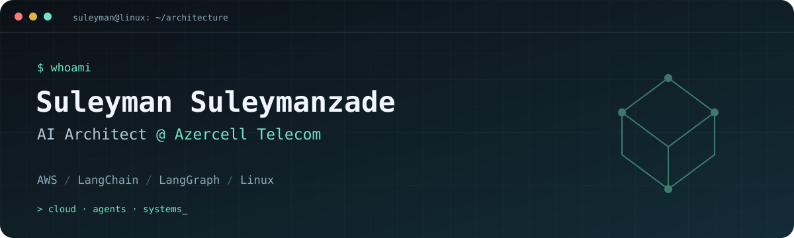

<p align="center">
  
</p>

<p align="center">
  <strong>AI Architect @ Azercell Telecom · Baku, Azerbaijan</strong><br />
  Cloud architecture. Agent workflows. A Linux terminal always within reach.
</p>

<p align="center">
  
  
  
  
</p>

### `$ whoami`

I'm Suleyman, an **AI Architect at Azercell Telecom**. My work brings together **AWS**, **LangChain**, and **LangGraph**, with **Linux** as my everyday environment.

My public repositories span LLM applications, tool-connected agents, machine learning, and systems programming. I enjoy exploring the layers beneath an application, from transformer internals to concurrency and operating systems.

### `$ ls featured/`

| Project | What's inside |
| :--- | :--- |
| [MCP Playground](https://github.com/SuleymanSuleymanzade/mcp-playground) | A Streamlit LLM chat app with MCP tool support, LangChain, LangGraph, and Docker. |
| [Transformer From Scratch](https://github.com/SuleymanSuleymanzade/TransformerFromScratch) | A Python implementation exploring attention and transformers. |
| [LLM](https://github.com/SuleymanSuleymanzade/LLM) | Large language model development experiments. |
| [Concurrency Patterns](https://github.com/SuleymanSuleymanzade/concurrency_patterns) | Concurrency patterns for distributed systems and cloud computing. |
| [s_os](https://github.com/SuleymanSuleymanzade/s_os) | A small operating system written in Rust. |

### `$ cat interests.txt`

```text
AI           → LLM applications · agents · tool integration
Cloud        → AWS · architecture · distributed systems
Foundations  → deep learning · transformers · concurrency
Environment  → Linux · terminal · open source
```

---

<p align="center">
  <a href="https://github.com/SuleymanSuleymanzade?tab=repositories">Explore my repositories</a>
</p>
